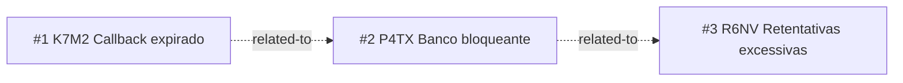

<!-- GENERATED, DO NOT EDIT: regenerado por /reversa-debugger-graph em 2026-09-24 a partir de 3 bugs -->

# Grafo de bugs

As relações são propostas. O cluster converge na responsividade do bot. O impact score é zero para todos porque relações propostas não entram na heurística.
